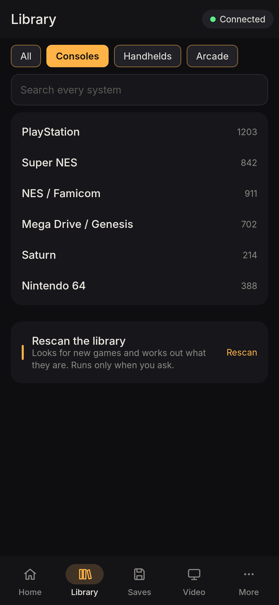
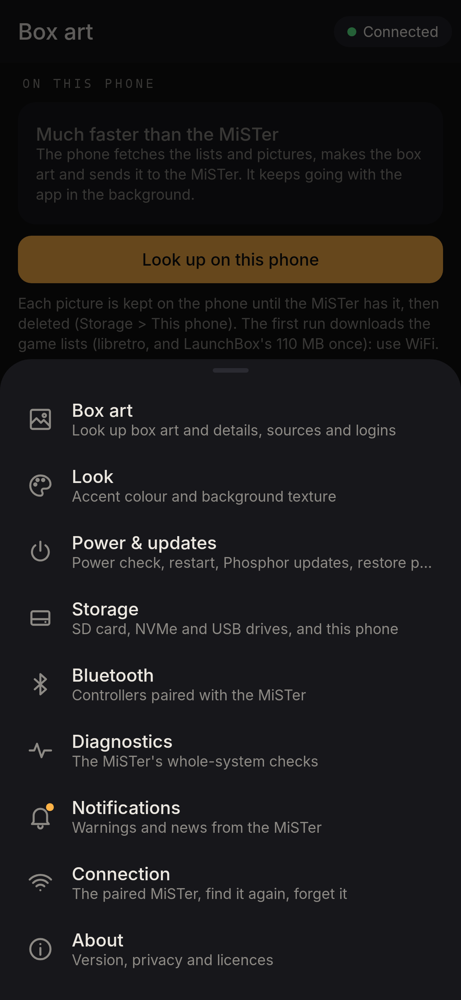
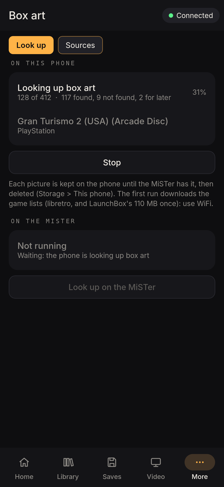
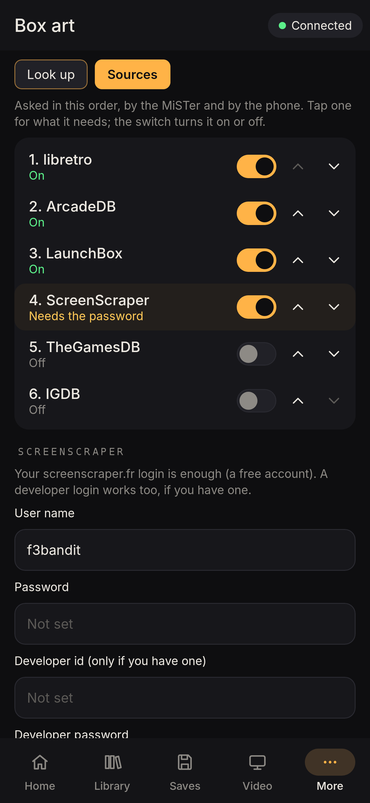
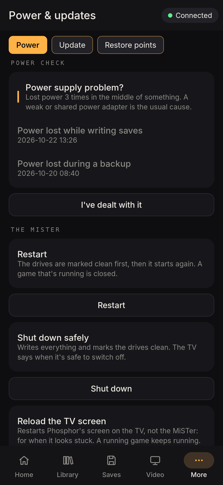
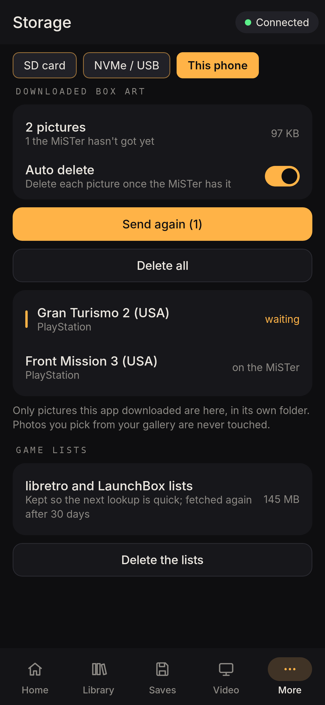
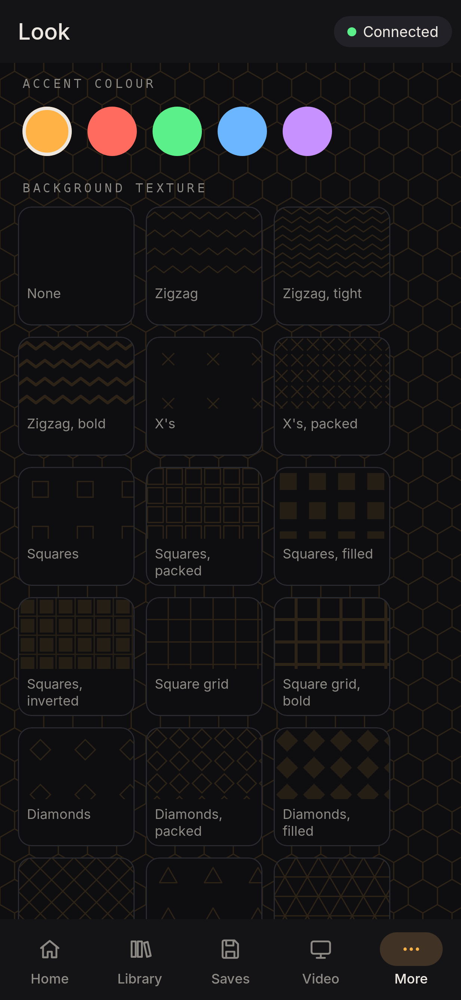
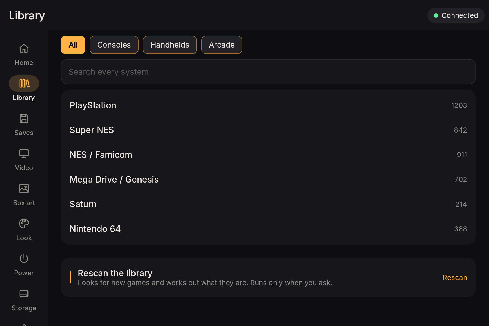

# Phosphor for Android

The phone and tablet app for Phosphor (0.8.0): browse the MiSTer's library, fix box art and details, set
"Based on" links and start games on the TV; look up box art on the phone; saves (memory cards, backups,
cloud), screen filters, power and updates, storage, Bluetooth (read only), diagnostics and notifications.
Over the home network only. Android 8 and later. A separate app from SS1 Tool for Android, with the same
navigation.

| | | | |
|---|---|---|---|
|  |  |  |  |

## Using it

1. On the MiSTer: **Settings > Remote access**, turn it on, choose **Pair a device**.
2. In the app: pick the MiSTer it found on the WiFi (or type the address from the TV), enter the 6-digit code.

Getting around works like SS1 Tool for Android: the app bar shows the section and the connection; on a phone
the bottom bar has **Home, Library, Saves, Video** and **More** (a sheet with the rest); on a tablet a rail
on the left has every section. Sections with tabs show them as chips under the app bar. Back closes the
sheet, then goes back through what you opened.

- **Home**: Continue (the last game: Play on TV), Needs attention (no box art, no details, not found),
  Favorites, Recently played.
- **Library**: the shelf by category (chips), search across every system, **Rescan** (runs only when you ask).
  A game: Play on TV, Favorite, Change box art (a photo; the phone shrinks it), Edit details, Based on.
- **Saves**: Memory cards (back up the card in port 1 or 2, put one back; the card is backed up first; the
  DualShock analog switch), Backups (the MiSTer's snapshots: back up now, restore saves or everything), Cloud.
  The controller tester and WiFi setup are on the MiSTer itself.
- **Video**: screen filters per system (backed up on the MiSTer before each change; Undo).
- **Box art**: **Look up on this phone** (much faster than the MiSTer: the phone fetches libretro's lists,
  ArcadeDB, LaunchBox and the keyed services you set up, matches with the MiSTer's own rules, makes the box
  art and sends it with the details; it keeps going in the background with a notification and a Stop
  button), or **Look up on the MiSTer**. **Sources**: order, on/off and logins (saved on the MiSTer).
- **Look**: the app's accent colour and background texture (the MiSTer's five colours and textures).
- **Power & updates**: the power check, Restart, Shut down safely, Reload the TV screen; installing a
  Phosphor package that's on the MiSTer, or rolling back; restore points (put back settings an update reset).
- **Storage**: the SD card, NVMe and USB drives (free space, Gen 4 warning, checks, repair, mount again), and
  **This phone**: box art the phone downloaded. Each picture is kept until the MiSTer has it, then deleted
  (**Auto delete**, on unless turned off); one the MiSTer didn't get can be sent again; Delete all. Photos
  picked from the gallery are never touched. The game lists the lookup keeps (libretro, LaunchBox) can be deleted too.
- **Notifications**: a power supply problem, settings an update reset, a Gen 4 drive, a failed storage check,
  a drive nearly full, a Phosphor update waiting on the MiSTer, box art finishing. Checked every minute with
  the app open and about every 15 minutes in the background (on WiFi); Android notifications can be turned off.
- **Connection**: the paired MiSTer; **Find it on this WiFi** when the router gave it a new address; Forget.

| | | | |
|---|---|---|---|
|  |  |  |  |

On a tablet: 

Changes show on the TV straight away. Forgetting the MiSTer (Connection) or removing the phone on the MiSTer
(Settings > Remote access, X) means pairing again.

## Privacy

The app talks only to the paired MiSTer, on the home network (plain HTTP, like MiSTer's own FTP and SMB),
and, when you look up box art on the phone, to the sources you turned on (libretro, ArcadeDB, LaunchBox,
and with your own logins TheGamesDB, ScreenScraper, IGDB). No accounts, no analytics, nothing sent anywhere
else. The device key is encrypted with the Android Keystore. The logins are saved on the MiSTer; the phone
holds them in memory only while it looks up box art.

## Building

```
cd apps/android
./gradlew assembleDebug            # app/build/outputs/apk/debug/app-debug.apk
./gradlew testDebugUnitTest        # screenshots of every screen in app/build/screenshots/
```

Needs JDK 17+ and the Android SDK (platform 36). Kotlin, Jetpack Compose, no other libraries.
`ApiTest` runs against a real phosphord when `PHOSPHOR_TEST_ADDR`, `PHOSPHOR_TEST_CODE` (an open pairing
code) and `PHOSPHOR_TEST_PNG` are set; `PhoneScrapeTest` (the same two) tries every command 0.8 added and a
whole box art run on the "phone"; `LaunchBoxTest` (`PHOSPHOR_TEST_LAUNCHBOX=1`) downloads and reads LaunchBox. GitHub Actions ("Android app") builds the APKs; the release APK is
signed when the signing secrets are set (see `.github/workflows/android.yml`).

The API it uses: [docs/remote-api.md](../../docs/remote-api.md).

## Licence

PolyForm Noncommercial 1.0.0, like the rest of Phosphor. Fonts: Inter (SIL OFL 1.1), DejaVu Sans Mono
(Bitstream Vera licence), subset to Latin.
