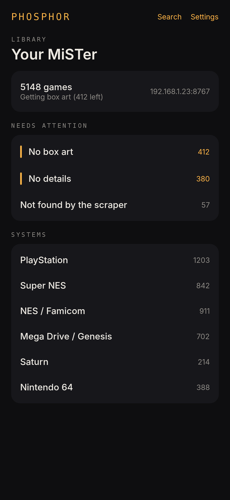
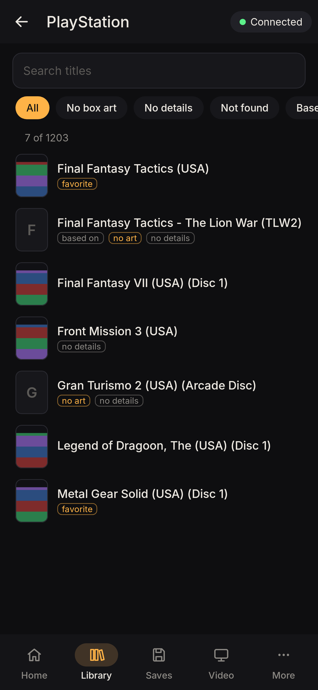
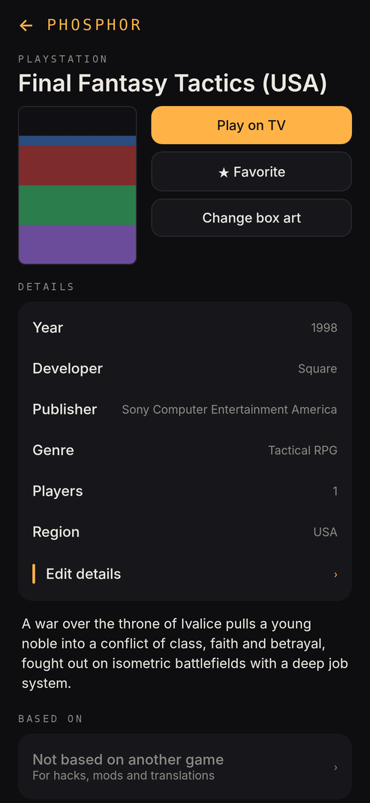
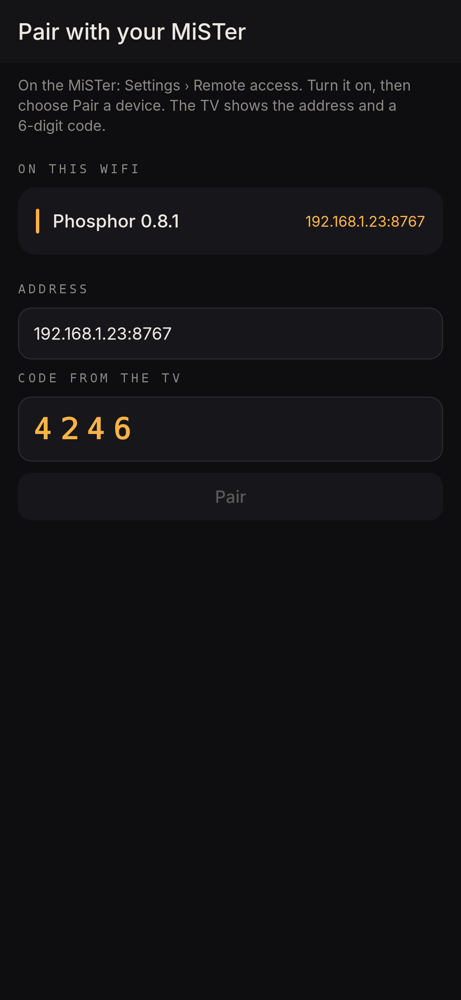

# Phosphor for Android

The phone and tablet app for Phosphor: browse the MiSTer's library, fix box art and details, set "Based on"
links and start games on the TV, over the home network. Android 8 and later.

| | | | |
|---|---|---|---|
|  |  |  |  |

## Using it

1. On the MiSTer: **Settings > Remote access**, turn it on, choose **Pair a device**.
2. In the app: pick the MiSTer it found on the WiFi (or type the address from the TV), enter the 6-digit code.
3. The library opens. **Needs attention** lists games without box art or details; tap one to fix it:
   - **Change box art**: pick a photo or a downloaded cover; the phone shrinks it, the MiSTer stores it.
   - **Edit details**: title, year, developer, publisher, genre, players, region, description.
   - **Based on**: for hacks, mods and translations, pick the original game.
   - **Play on TV** starts the game; **Favorite** marks it.
4. **Settings > Cloud saves**: send now, get saves back (pick a MiSTer, see what would change), add a
   storage place: WebDAV, SFTP, SMB, or Google Drive / Dropbox / OneDrive by pasting the sign-in token from
   `rclone authorize` on a PC. Passwords and tokens go only to the MiSTer; WiFi, Bluetooth pairings and
   passwords are never sent to the cloud.

Changes show on the TV straight away. Forgetting the MiSTer (Settings) or removing the phone on the MiSTer
(Settings > Remote access, X) means pairing again.

## Privacy

The app talks only to the paired MiSTer, on the home network (plain HTTP, like MiSTer's own FTP and SMB).
No accounts, no analytics, nothing sent anywhere else. The device key is encrypted with the Android Keystore.

## Building

```
cd apps/android
./gradlew assembleDebug            # app/build/outputs/apk/debug/app-debug.apk
./gradlew testDebugUnitTest        # screenshots of every screen in app/build/screenshots/
```

Needs JDK 17+ and the Android SDK (platform 36). Kotlin, Jetpack Compose, no other libraries.
`ApiTest` runs against a real phosphord when `PHOSPHOR_TEST_ADDR`, `PHOSPHOR_TEST_CODE` (an open pairing
code) and `PHOSPHOR_TEST_PNG` are set. GitHub Actions ("Android app") builds the APKs; the release APK is
signed when the signing secrets are set (see `.github/workflows/android.yml`).

The API it uses: [docs/remote-api.md](../../docs/remote-api.md).

## Licence

PolyForm Noncommercial 1.0.0, like the rest of Phosphor. Fonts: Inter (SIL OFL 1.1), DejaVu Sans Mono
(Bitstream Vera licence), subset to Latin.
