# Phosphor shell

The Phosphor interface: a console-style library for MiSTer, drawn on the Linux framebuffer with
[LVGL](https://lvgl.io) 9.6 (MIT). One static ARM binary, about 1.4 MB, with no dependencies on
MiSTer's Linux. Everything it shows comes from [`phosphord`](../system/), the system service; the
shell starts it if it isn't running.

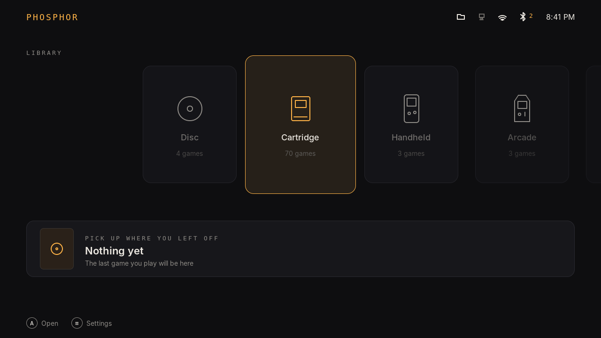

| Systems in a category | Games | Settings |
|---|---|---|
| 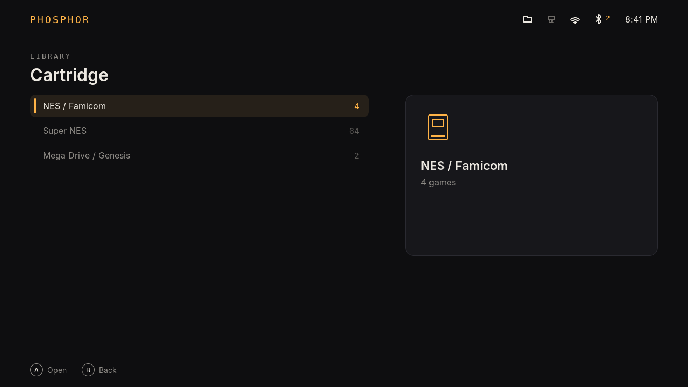 | 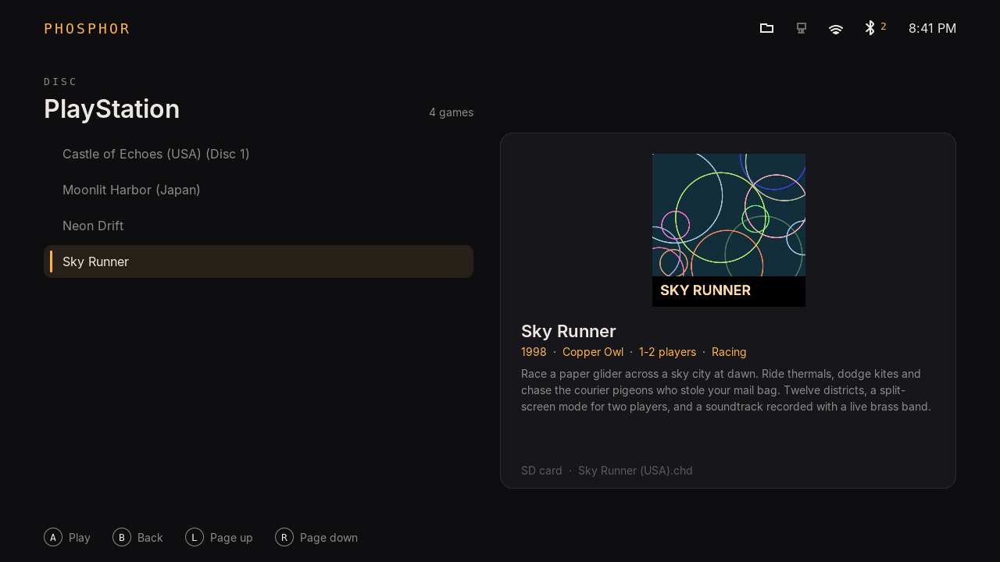 | 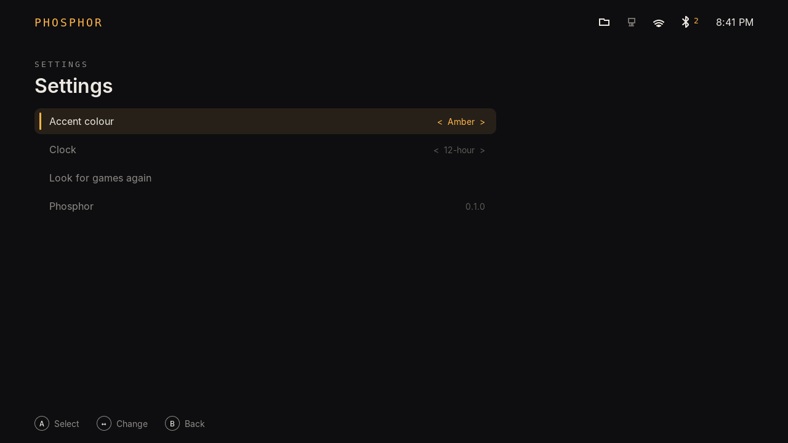 |

## What works

- **Home**: category shelf (Disc, Cartridge, Handheld, Arcade, Computer) with game counts, and
  "Pick up where you left off" with the last game's box art and play time (X plays it).
- **Systems → games**: only systems with games are listed; systems without their core are dimmed.
  The game list stays fast with thousands of games (rows are reused).
- **Game details**: box art at the top, then title, year · publisher · players · genre, the
  description, and where the file lives (SD card, USB/NVMe, network share; "not connected" when
  its drive is away). Art loads a moment after the selection settles, so scrolling stays quick.
- **Based on** (Y in the games list): for a hack, mod or translation, pick the game it was made
  from; the most alike titles are listed first. It then shows that game's box art and description
  under its own name, with "Based on …" in its details. "Not based on another game" undoes it.

  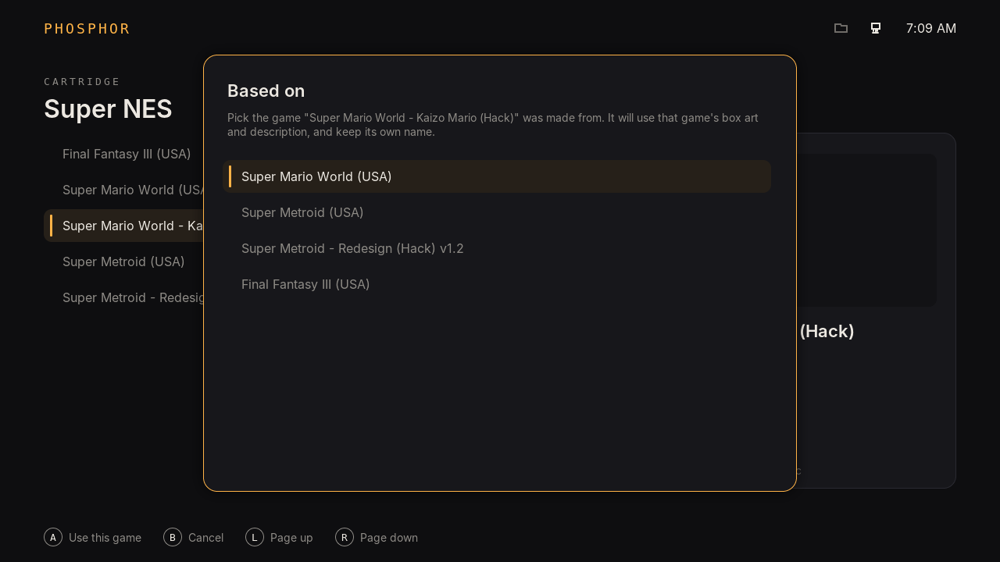
- **Box art** is shown whether phosphord stored it as JPEG (scraped) or PNG (imported); JPEGs are
  decoded whole (stb_image) so they scale to fit.
- **Launching** goes through phosphord, which records play count and time.
- **Refreshes by itself** when phosphord finishes a scan (a drive or share was plugged in) or finds
  that two entries are the same game.
- **Status bar**: network share, Ethernet, WiFi signal, Bluetooth with connected count, clock.
- **Controllers and keyboards** through evdev, picked up when plugged in, with key repeat. D-pad,
  hat or left stick; south button / Enter = A, east / Esc = B, north / Y key = Y, Start / Guide / F1 = Menu, shoulders
  or PgUp/PgDn = page.
- **Background textures** (Settings): none, zigzag, X's, squares, triangles, circles, hexagons or
  8-bit tiles (original pixel art), drawn faintly in the accent colour and redrawn when it changes.
  Each is one small tile made in code and repeated, so they cost nothing while scrolling.

  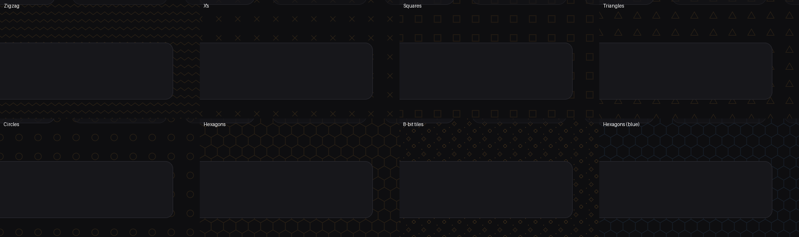
- **Settings**: accent colour (Amber, Red, Green, Blue, Purple), background texture, 12/24-hour clock, get box art and
  details (on/off, with progress: found, to go, not found), box art sources (on/off and order:
  A toggles, Y/X move up/down), look for games again, Diagnostics.
- **WiFi** (Settings): networks in range (mesh access points grouped, strongest first) and saved ones;
  A joins (asks for the password on the on-screen keyboard), X forgets, Y scans, SELECT undoes the
  last change; "Other network..." for hidden ones.
- **On-screen keyboard**: D-pad moves, A types, X deletes, Y switches letters / capitals / symbols,
  Start is done, B cancels.
- **Welcome** (first start of a new install, no `frontend.ini` yet): network (opens WiFi), box art lookup
  on/off, accent colour, pairing the phone app, cloud saves, then Start. Every step is optional and in
  Settings later; existing installs never see it.

  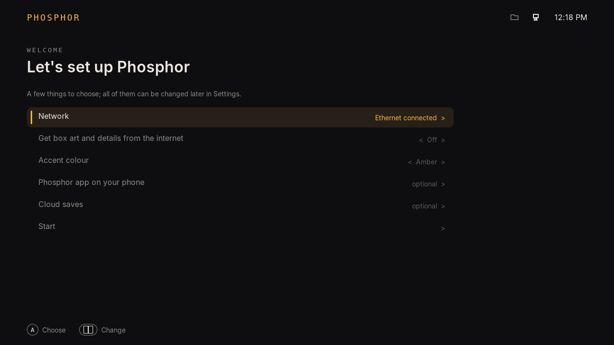

- **Controllers & memory cards** (Settings): the PlayStation controllers on the SuperStation One's
  front ports, live (type, buttons, sticks; switch DualShocks to analog), memory card backups (the whole
  card to `phosphor/memcards`, `.mcd` like MiSTer's PSX core) and putting a backup back on a card (the
  card is backed up first). Needs phosphor-main; loads the Phosphor menu core if the stock one is loaded.
  The front-port controllers also move around Phosphor (Cross confirms, Circle goes back, Start opens
  Settings); one setting on that screen turns this off.

  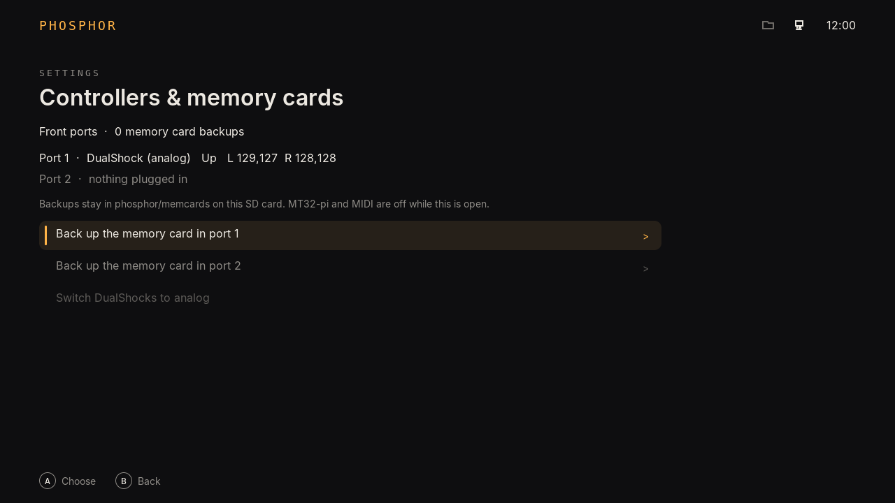

- **Bluetooth** (Settings): the paired controllers, connected or not; pair a new one (put it in pairing mode;
  MiSTer's own pairing tool does the work, so the OSD and Phosphor share the same pairings); disconnect or
  forget one. Pairings stay on the SD card.

  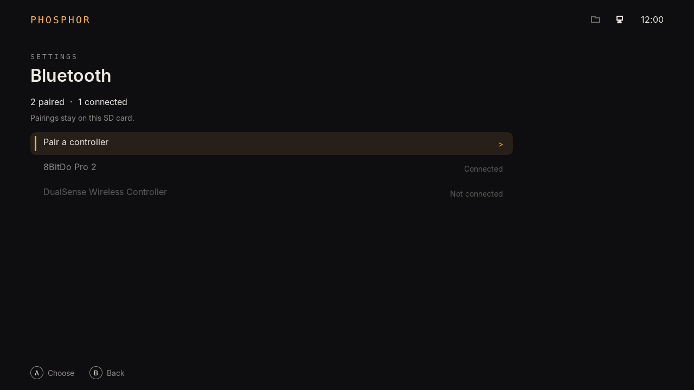

- **Backups** (Settings): the backup-agent snapshots with date, reason and size; Back up now; pick one to
  see the saves in it, then A restores saves only or X everything (settings too). A safety backup is
  taken first, so a restore can be undone from the same list.
- **Cloud saves** (Settings): where saves go and when they were last sent; Send now; Get saves back (pick
  a MiSTer, see what would change, then A); storage places (add WebDAV, SFTP or SMB with the on-screen
  keyboard; Google Drive, Dropbox and OneDrive from the phone app); Check the connection.
- **Remote access** (Settings): on/off, the address, "Pair a device" (shows a 6-digit code for 2 minutes),
  paired devices with when they were last used; X forgets one.

  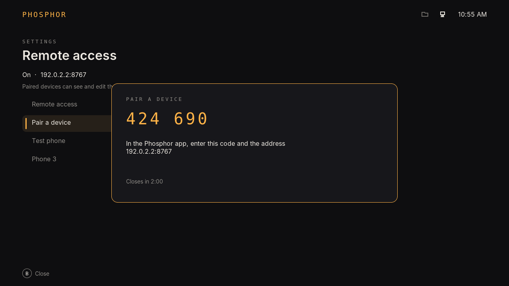

- **Screen filters** (Settings): per system, apply a preset or pick each filter, shadow mask and size,
  and gamma from MiSTer's own folders; shows the next time the core starts; SELECT undoes.

  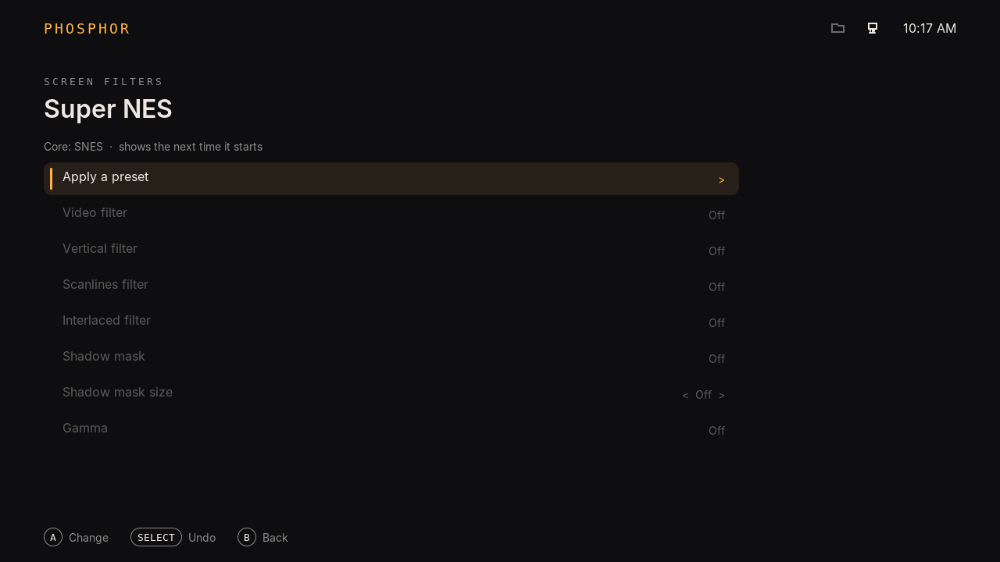

- **Diagnostics** (Settings): the diag module's checks of the whole system, problems first, then
  warnings, then everything that's fine. Y checks again; X saves a report for support (a .tar.gz in
  `phosphor/logs`, passwords removed). Saved in `/media/fat/phosphor/config/frontend.ini`.
- **While a game runs** (MiSTer's `/tmp/CORENAME` isn't `MENU`) it sleeps and ignores input.
- Logs to `/tmp/phosphor/frontend.log`, and to the serial console with `--log-serial`.

## Build

```
cmake -B build && cmake --build build -j                     # this machine: snapshots and checks
cmake -B build-arm -DCMAKE_TOOLCHAIN_FILE=cmake/armhf.cmake && cmake --build build-arm -j
                                                              # MiSTer: build-arm/phosphor
```

Needs `gcc`, `cmake` and, for the MiSTer build, `arm-linux-gnueabihf-gcc`. The MiSTer binary is
linked statically because MiSTer's Linux has glibc 2.31. Fonts are pre-converted in `fonts/`;
`tools/make_fonts.sh` regenerates them (Inter, SIL OFL; DejaVu Sans Mono).

## Screenshots without a screen

```
build/phosphor --snapshot out.ppm --keys right,a,down,a
```

renders the interface in memory after pressing those keys and saves a picture. It waits for
phosphord's first scan. For a test library point both at the same folders:
`PHOS_FAT=/path/to/fake/fat PHOS_GAMES_ROOTS=/path/to/games PHOS_TMP=/tmp/test PHOS_MISTER_CMD=/tmp/cmd.txt`,
and `PHOSD_BIN=../system/build/phosphord` so the shell can start it.
`PHOS_FAKE_STATUS="share=1,eth=0,wifi=3,bt=2"` and `PHOS_FAKE_CLOCK="8:41 PM"` fix the status bar.
The ARM shell and ARM phosphord, run together under `qemu-arm-static`, render the same picture
pixel for pixel as the host builds.

## With phosphor-main (Phosphor's Main fork)

When [phosphor-main](https://github.com/f3bandit/phosphor-main) is running, the shell connects to its
API (`/tmp/phosphor-main.sock`, `src/mainlink.c`) and takes the screen itself: no F9, and Main's menu
ignores the controls while the shell is up. If the shell stops, Main takes the screen back; if Main
restarts, the shell takes it again. Trying it (undone by a reboot):

```
killall MiSTer MiSTer_ConsoleMode; sleep 1; /media/fat/phosphor/bin/MiSTer_phosphor &
sleep 3; /media/fat/phosphor/phosphor.sh start
```

## Trying it on a MiSTer (stock Main)

With stock Main the Linux framebuffer has to be switched on by hand:

1. Copy `build-arm/phosphor` and `../system/build-arm/phosphord` to `/media/fat/phosphor/bin/`.
2. In the MiSTer menu, press **F9** on a keyboard to show the Linux screen.
3. Over SSH: `/media/fat/phosphor/bin/phosphor` (add `--log-serial` to watch the log on the debug
   port). It asks Main for a 1280x720 framebuffer (`fb_cmd1`).
4. If red and blue look swapped, start it with `--fb-rb 0`. `--fb-mode none` leaves the mode alone.

Stock Main still reacts to the controller in the menu at the same time (phosphor-main fixes that).

## Systems and launch settings

These live in phosphord now: see [`../system/config/systems.ini`](../system/config/systems.ini).

## Layout

```
src/main.c       entry, framebuffer loop, snapshot mode
src/ui.c         screens, shelf animation, virtual list, footer, toast
src/api.c        phosphord client (starts it if needed)
src/input.c      evdev, hot-plug, repeat
src/sysinfo.c    status bar data
src/icons.c      outline icons drawn as vectors (our own designs)
src/theme.c      palette, accents, scaling (designed at 1280x720)
src/settings.c   frontend.ini
fonts/           pre-converted fonts
third_party/lvgl LVGL 9.6.0 (MIT; see its LICENCE.txt and COPYRIGHTS.md)
```

## Licence

PolyForm Noncommercial 1.0.0, like the rest of this repository. LVGL and cJSON are MIT; Inter is SIL OFL 1.1;
DejaVu Sans Mono is under the Bitstream Vera licence. Nothing GPL is linked: LVGL's FreeType and
FrogFS integrations stay switched off.
